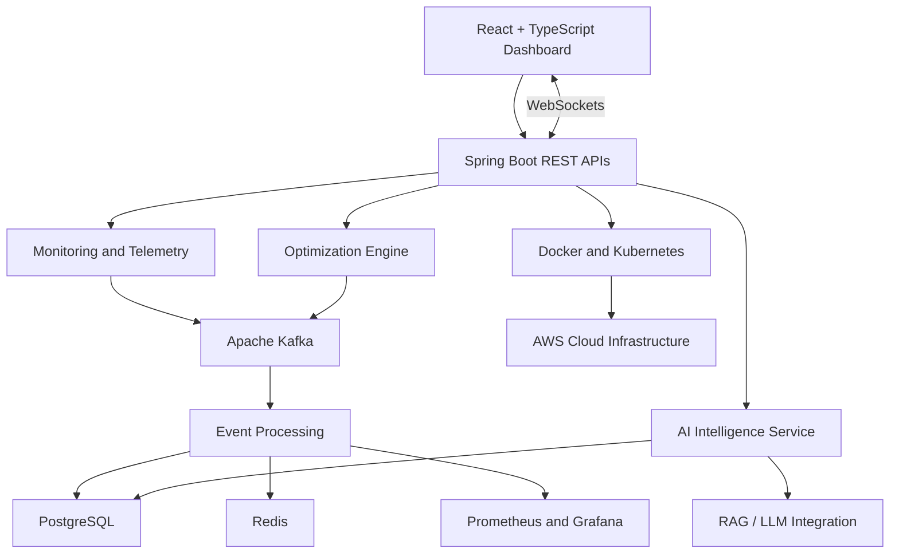

# NEXUS — Real-Time Infrastructure Optimization & AI Intelligence Platform

**NEXUS** is an intelligent infrastructure management platform designed to monitor distributed systems, identify resource conflicts, optimize workload scheduling, and assist with incident analysis using AI.

By combining distributed systems, graph-based optimization algorithms, event-driven architecture, and AI-powered operational intelligence, NEXUS aims to help engineering teams build more reliable, efficient, and observable cloud infrastructure.

## 🚀 Key Features

- **Real-Time Infrastructure Monitoring** — Track CPU utilization, memory consumption, service health, and operational events.
- **Intelligent Resource Optimization** — Identify resource contention and recommend efficient resource allocation.
- **Graph-Based Workload Scheduling** — Model service dependencies and optimize scheduling using graph algorithms and constraint-aware strategies.
- **Event-Driven Processing** — Process infrastructure events asynchronously through Apache Kafka.
- **AI-Powered Incident Intelligence** — Generate context-aware incident explanations and remediation suggestions using retrieval-augmented generation (RAG) and LLMs.
- **Anomaly Detection** — Identify unusual infrastructure behavior and support predictive operational alerts.
- **Live Monitoring Dashboard** — Visualize infrastructure metrics, service dependencies, alerts, and optimization insights.
- **Failure Simulation & Recovery Analysis** — Evaluate potential failure scenarios and analyze recovery strategies.
- **Real-Time Notifications** — Deliver operational updates and incident alerts using WebSockets.
- **Scalable Data Architecture** — Use PostgreSQL for persistent storage and Redis for low-latency data access.

## 🏗️ System Architecture

NEXUS follows a modular, event-driven architecture designed to separate monitoring, optimization, data processing, and AI-assisted operations.



## 🛠️ Technology Stack

| Layer | Technologies |
|---|---|
| Frontend | React.js, TypeScript |
| Backend | Java, Spring Boot |
| API Communication | REST APIs, WebSockets |
| Event Streaming | Apache Kafka |
| Database | PostgreSQL |
| Caching | Redis |
| AI / Machine Learning | Python, FastAPI, scikit-learn |
| AI Intelligence | RAG, LLM integrations |
| Monitoring | Prometheus, Grafana |
| Containerization | Docker |
| Orchestration | Kubernetes |
| Cloud Infrastructure | AWS |
| Version Control | Git, GitHub |

## ⚙️ Core Modules

### 1. Infrastructure Monitoring
Collect and process infrastructure telemetry to track resource utilization, service availability, and operational health.

### 2. Optimization Engine
Analyze resource constraints and service dependencies to identify conflicts and recommend better workload placement and scheduling strategies.

### 3. Event Processing Pipeline
Use Kafka to decouple infrastructure event producers from consumers, enabling asynchronous processing and scalable event-driven workflows.

### 4. AI Operations Assistant
Use infrastructure context and relevant operational records to explain incidents, assist with root-cause analysis, and generate evidence-based remediation recommendations.

### 5. Live Operations Dashboard
Provide a unified interface for monitoring system health, reviewing alerts, exploring service dependencies, and inspecting optimization results.

## 🧠 Engineering Concepts

NEXUS explores practical applications of:

- Distributed systems and asynchronous communication
- Event-driven microservice architecture
- Graph algorithms and constraint-based optimization
- Real-time data processing
- Caching and persistent data management
- Observability and incident analysis
- AI-assisted root-cause investigation
- Containerization and cloud deployment
- Reliability and fault-recovery strategies

## 📁 Project Structure

The following is a proposed logical structure. Adapt the paths to match the actual repository.

```text
nexus/
├── frontend/             # React + TypeScript dashboard
├── backend/              # Spring Boot application
│   └── src/
├── ai-service/            # Python / FastAPI intelligence service
├── infrastructure/        # Docker, Kubernetes and deployment files
├── monitoring/             # Prometheus and Grafana configuration
├── docs/                   # Architecture and technical documentation
├── docker-compose.yml
├── .env.example
├── .gitignore
└── README.md
```

## 💻 Getting Started

### Prerequisites

Install the tools required by the components you intend to run:

- Git
- Node.js and npm
- Java Development Kit (JDK)
- Maven or the project's configured build tool
- Python and pip, if the AI service is enabled
- Docker and Docker Compose
- PostgreSQL, Redis, and Kafka, or equivalent configured services

### 1. Clone the Repository

```bash
git clone <YOUR_GITHUB_REPOSITORY_URL>
cd nexus
```

### 2. Configure Environment Variables

Create a local `.env` file using the project's example configuration, if available.

```env
DATABASE_URL=jdbc:postgresql://localhost:5432/nexus
REDIS_HOST=localhost
REDIS_PORT=6379
KAFKA_BOOTSTRAP_SERVERS=localhost:9092
```

Configure credentials, ports, and service-specific settings according to your implementation. Never commit production secrets or API keys.

### 3. Start Infrastructure Services

If the repository contains a working Docker Compose configuration:

```bash
docker compose up -d
```

### 4. Start the Backend

From the Spring Boot backend directory, use the build tool configured by the project. For Maven projects:

```bash
./mvnw spring-boot:run
```

On Windows, use:

```powershell
.\mvnw.cmd spring-boot:run
```

### 5. Start the Frontend

```bash
cd frontend
npm install
npm run dev
```

### 6. Start the AI Service

If the optional Python service is implemented, install its dependencies and start it using the configured application entry point.

```bash
cd ai-service
pip install -r requirements.txt
```

The exact launch commands, environment variables, and service ports depend on the actual repository configuration. Refer to the corresponding component documentation before running the complete system.

## 🔌 API Design

The backend is intended to expose REST endpoints for infrastructure management and optimization.

Potential endpoint groups include:

| Endpoint | Purpose |
|---|---|
| `/api/health` | Service health checks |
| `/api/metrics` | Retrieve infrastructure metrics |
| `/api/services` | Inspect registered services |
| `/api/events` | Access operational events |
| `/api/optimization` | Submit or retrieve optimization results |
| `/api/incidents` | Review incident information |
| `/api/ai/analyze` | Request AI-assisted incident analysis |

These are illustrative endpoint names, not a verified API contract. Update them to reflect the routes implemented in the backend.

## 📊 Observability and Reliability

The intended monitoring layer can integrate Prometheus and Grafana to support:

- Infrastructure and application metrics
- Service health and availability monitoring
- Resource utilization trends
- Event-processing performance
- Incident investigation
- Optimization outcome evaluation

## 🔐 Security Considerations

- Store credentials and API keys in environment variables or a secrets manager.
- Apply authentication and authorization to protected endpoints.
- Validate incoming requests and sanitize untrusted input.
- Restrict access to infrastructure management operations.
- Use secure communication channels and appropriate database permissions.
- Audit sensitive operational actions.

## 🗺️ Roadmap

- [ ] Complete real-time telemetry ingestion.
- [ ] Implement resource conflict detection.
- [ ] Build graph-based workload scheduling.
- [ ] Integrate Kafka-based event processing.
- [ ] Add live dashboard updates through WebSockets.
- [ ] Integrate anomaly detection and AI-assisted incident analysis.
- [ ] Add failure simulation and recovery analysis.
- [ ] Containerize services and prepare Kubernetes deployment.
- [ ] Add automated testing, CI/CD, and performance benchmarks.

Roadmap items should be checked off only when the corresponding functionality is implemented and tested.

## 🎯 Project Objective

The objective of NEXUS is to explore how software engineering, distributed systems, cloud technologies, optimization algorithms, and artificial intelligence can work together to improve infrastructure observability and operational efficiency.

The project is intended as a practical exploration of production-oriented system design, with emphasis on modular architecture, scalable event processing, intelligent optimization, and reliable operations.

## 👩‍💻 Author

**Sakshi Kumari**

B.Tech — Computer Science and Engineering

- GitHub: [Tiwary26](https://github.com/Tiwary26)
- LinkedIn: https://www.linkedin.com/in/sakshi-tiwary22/

## 📄 License

Choose a license appropriate for your project and add the corresponding `LICENSE` file before claiming that the repository is distributed under that license.

---

**NEXUS — Making Cloud Infrastructure Smarter, More Efficient, and More Resilient.**
